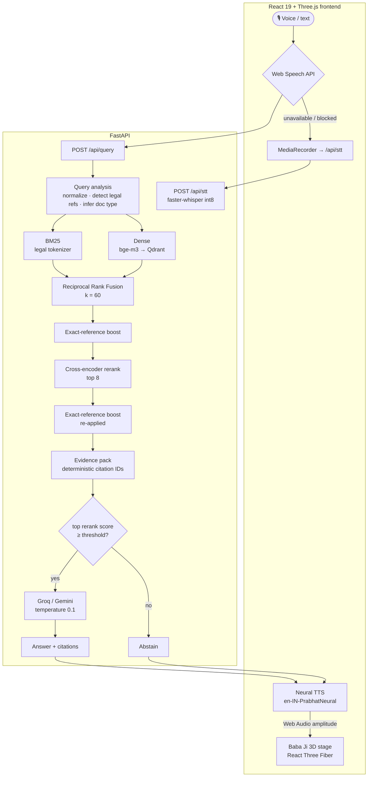
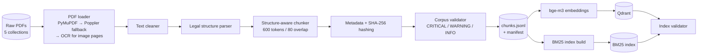

<div align="center">

# ⚖️ IP-SAKTI Sahayak

**A voice-first, citation-grounded legal research assistant for Indian intellectual property and traditional-knowledge law. Ask a question out loud, and a 3D scholar avatar ("Baba Ji") answers with sources.**

[](https://sih.gov.in)


<br/>


[Architecture](#architecture) · [Retrieval design](#retrieval-design-built-for-legal-text) · [Grounding](#grounding-and-abstention) · [Quick start](#quick-start) · [Team](#team)

</div>

---

## The problem

Ayush practitioners and innovators who want to protect an Ayurvedic formulation face a maze of statutes, rules, examination guidelines and international treaties: the Patents Act, the Biological Diversity Act, the Drugs and Cosmetics Rules, the TK examination guidelines, the Nagoya Protocol and the WIPO treaty on genetic resources and traditional knowledge. General-purpose chatbots answer these questions fluently, and they often invent section numbers, which is the worst possible failure for legal guidance.

**IP-SAKTI Sahayak answers only from an indexed corpus of authoritative legal documents, cites every claim back to a specific chunk, and declines to answer when the evidence isn't strong enough.** It is wrapped in a voice-and-avatar experience so that non-specialists can simply speak their question.

### At a glance

| | |
|---|---|
| **Corpus** | 12 legal documents in 5 collections · 1,095 pages · 895 structure-aware chunks |
| **Retrieval** | BM25 (custom, legal-aware tokenizer) + dense (`bge-m3` on Qdrant) → Reciprocal Rank Fusion → cross-encoder reranking |
| **Legal awareness** | Statute-structure parsing (Part, Chapter, Section, Clause, Proviso, ...), plus boosting of exact references such as "Section 3(d)" |
| **Grounding** | Strict citation-only prompt, deterministic citation IDs, and abstention when the best reranker score falls below a threshold |
| **Resilience** | Every component degrades on its own (hybrid → BM25-only or dense-only; cross-encoder → passthrough; LLM → extractive fallback), and the current mode is reported on `/health` |
| **Voice** | Browser Web Speech API with a local **faster-whisper** fallback for STT; Edge neural TTS (`en-IN-PrabhatNeural`) driving amplitude-based lip-sync |
| **Built in** | 2 days for SIH 2026 (30 commits, 39 tests) |

---

## Architecture



### Offline pipeline



Ingestion and indexing are separate CLIs joined by one artifact, `chunks.jsonl`. You can re-embed with a different model or re-tune BM25 without re-parsing a single PDF.

---

## Retrieval design: built for legal text

Legal queries mix two very different needs. *"What does Section 3(d) say?"* is an exact-match lookup, while *"Can I patent a known herbal formulation?"* is a semantic question. Each design decision below follows from that split.

| Decision | Why |
|---|---|
| **Hybrid BM25 + dense with RRF** | Dense retrieval understands paraphrase ("traditional remedy" ≈ "TK-based formulation") but blurs exact identifiers. BM25 matches "3(d)" exactly but misses synonyms. RRF fuses the two by **rank**, which needs no score calibration between incompatible scales. |
| **BM25 implemented from scratch** with a **legal-aware tokenizer** | Standard tokenizers break `section 3(1)(a)` into `section`, `3`, `1`, `a`, which destroys the most important signal in a legal query. The custom regex keeps references such as `section 3(1)(a)` and `article 5` as single tokens. |
| **Exact-reference boost, applied before *and* after reranking** | Query analysis extracts Section, Article, Rule and Chapter references and maps act names ("Patents Act", "Nagoya Protocol") to source documents. Chunks that match get a small additive boost. It is re-applied after the cross-encoder, because a general-domain reranker (MS MARCO) does not know that the literal statute text outranks commentary about it. |
| **Cross-encoder reranking** (`ms-marco-MiniLM-L-6-v2`) over the top 40 | Bi-encoders retrieve quickly; a cross-encoder reads the query and passage together, so it judges relevance more precisely. Running it only on the fused shortlist keeps it affordable on CPU. |
| **`BAAI/bge-m3` embeddings** | Strong on long, formal text and multilingual, which allows for Hindi or Hinglish queries later. The model revision can be pinned through `EMBEDDING_MODEL_REVISION` so embeddings are reproducible. |
| **Structure-aware chunking** | The parser tracks the legal hierarchy (Part → Chapter → Section → Subsection → Clause → Proviso → Explanation, plus Schedules, Articles, Rules and case metadata). Chunks are cut at structural and paragraph boundaries first, then at sentences, and only as a last resort at a token window. |
| **Structure-enriched embedding text** | Each chunk is embedded with a header such as `TITLE / DOCUMENT TYPE / JURISDICTION / CHAPTER / SECTION`, so a clause that never repeats its act's name can still be found by it. |
| **Filters never hard-exclude** | Metadata filters skip chunks only on an explicit mismatch, never because metadata is missing. A weak domain guess should not throw away the right answer. |

---

## Grounding and abstention

For legal guidance, a confident wrong answer is worse than no answer, so the pipeline is designed to stay quiet unless the evidence supports an answer.

- **Evidence pack with deterministic citation IDs.** The reranked chunks become `[1] ... [n]`, each with document, section, page and source metadata. The model can only cite IDs it was given.
- **Abstention before generation.** If no chunks survive, or the best cross-encoder score is below `GROUNDING_MIN_SCORE`, the API returns a fixed abstention message with `grounded: false`, and **the LLM is never called**.
- **Strict system prompt (10 rules).** Answer only from the evidence; never invent statutes, sections, cases, page numbers or citations; separate directly supported claims from synthesis; flag contradictions between sources; prefer a conservative answer to a fluent one. Temperature is 0.1.
- **Failure messages stay out of the user's ears.** Raw backend exceptions are converted into a calm message on the frontend, and the retrieved evidence is still shown, so Baba Ji never reads a stack trace aloud.

---

## Data quality: validation that caught real problems

Both pipelines end with a validator that grades every finding as `CRITICAL`, `WARNING` or `INFO` and writes `validation_report.{json,txt}`. On the competition corpus it found:

- **A content collision.** `Patents_Act_1970_Updated.pdf` and `Trade_Marks_Act_1999.pdf` had 100% identical extracted pages, meaning the downloaded "Trade Marks Act" was actually a second copy of the Patents Act. Without hash-based duplicate detection, the system would have cited the Patents Act as trademark law.
- **An unreadable document.** All 5 pages of `API_Amendment_List_2023.pdf` came out empty because it is image-only. The loader detects pages like this (too little text, too few words) and has a Tesseract OCR path for them (250 DPI), but the competition build extracted text through the Poppler fallback, so OCR never ran.

Duplicate detection hashes whole files **and** each page's extracted text (SHA-256). That's how the collision was caught even though the two PDF files themselves were different.

The index validator also checks that the BM25 index, Qdrant and `chunks.jsonl` agree on chunk IDs and counts, that embedding dimensions match the manifest, and that no chunk is empty. Qdrant sync is **idempotent**: point IDs are derived deterministically from chunk IDs, and orphaned points are deleted before upsert.

---

## The experience layer: Baba Ji

<sub>Frontend and voice experience built by **Faizan Khan**. The full design spec is in [`master-prompt.md`](master-prompt.md).</sub>

- **3D scholar avatar** built with React Three Fiber + Drei, with idle, listening and speaking states driven by one conversation state.
- **Amplitude-driven lip-sync.** TTS audio is routed through a Web Audio `AnalyserNode`, and its amplitude moves the jaw and head every frame. This gives convincing speech at demo distance without a phoneme pipeline.
- **Voice in, with layered fallbacks.** The browser Web Speech API is tried first. If it can't reach Google's servers (firewall, offline or non-HTTPS), the app records with `MediaRecorder` and transcribes locally through `/api/stt` using **faster-whisper** (`base`, int8, CPU). Text input always works.
- **Voice out.** Microsoft Edge neural TTS (`en-IN-PrabhatNeural`) is served through a Vite middleware, with pre-synthesized clips for scripted lines (zero latency on stage) and the browser's `speechSynthesis` as a last resort.
- **An evidence panel** that shows the retrieved sources next to the spoken answer.

---

## Quick start

### Prerequisites

Docker, Python 3.11+, Node 20+, and a Groq or Gemini API key. Without a key the app still runs, using an extractive fallback generator.

### 1. Configure and start Qdrant and the API

```bash
git clone https://github.com/Anantha-Shayan/IP-SAKTI_Sahayak.git
cd IP-SAKTI_Sahayak
cp .env.example .env               # set GROQ_API_KEY (or LLM_PROVIDER=google + GEMINI_API_KEY)

docker compose up -d qdrant
python -m venv .venv && source .venv/bin/activate
pip install -r requirements.txt
```

### 2. Build the corpus and indexes

```bash
python -m backend.ingestion.cli --input data/raw --output data/processed/embedding_ready
python -m backend.indexing.cli build       # bge-m3 → Qdrant, plus the BM25 index
python -m backend.indexing.cli validate    # consistency checks across both indexes
```

### 3. Run

```bash
docker compose up -d backend               # or: python -m backend.api.main
cd frontend && npm install && npm run dev  # http://localhost:5173
```

```bash
curl -s localhost:8000/api/query -H 'Content-Type: application/json' \
  -d '{"query": "Is a known Ayurvedic formulation patentable under Section 3 of the Patents Act?"}' | jq
curl -s localhost:8000/health | jq         # shows which retriever, reranker and generator modes are live
```

### Tests

```bash
pytest          # 39 tests: ingestion, indexing, retrieval, RAG and API
```

---

## API

| Method | Endpoint | Description |
|---|---|---|
| `POST` | `/api/query` | Full pipeline: hybrid retrieval, reranking, grounding check, generation, then answer, citations, confidence and `grounded` |
| `POST` | `/api/retrieve` | Retrieval and reranking only. Returns query analysis plus hybrid and reranked results with per-method scores and ranks, for debugging and evaluation |
| `POST` | `/api/stt` | Local Whisper transcription of uploaded audio |
| `GET` | `/health` | `ok` or `degraded`, the active mode of each component, and initialization errors |

Every retrieval parameter can be set through the environment (`RETRIEVAL_*_TOP_K`, `RRF_K`, `BM25_K1`, `BM25_B`, `RERANKER_MODEL`, `GROUNDING_MIN_SCORE`, `LLM_*`, ...). See [`.env.example`](.env.example).

---

## Corpus

| Collection | Documents |
|---|---|
| **1 · Core IP statutes** | Patents Act 1970 (updated), Trade Marks Act 1999, Biological Diversity (Amendment) Act 2023 |
| **2 · Drug and advertising regulation** | Drugs and Cosmetics Act 1940 and Rules 1945, Drugs and Magic Remedies (Objectionable Advertisements) Act 1954, CCPA notification |
| **3 · Traditional knowledge** | TK Examination Guidelines, Ayurvedic Pharmacopoeia (API) Amendment List 2023 |
| **4 · International** | Nagoya Protocol (CBD), WIPO Treaty on IP, Genetic Resources and Associated TK (2024) |
| **5 · Practice and case law** | IPO Manual of Patent Practice and Procedure, WIPO TK Case Studies Digest |

---

## Project structure

```text
IP-SAKTI_Sahayak/
├── backend/
│   ├── ingestion/     # PDF loading (PyMuPDF / Poppler / OCR), cleaning, legal structure parser, chunker, validator
│   ├── indexing/      # bge-m3 embeddings, Qdrant REST sync, BM25 builder, manifest, index validation
│   ├── retrieval/     # query analysis, BM25 + dense retrievers, RRF fusion, filters, exact-reference boost
│   ├── reranking/     # Reranker protocol: cross-encoder | passthrough
│   ├── rag/           # pipeline orchestration, evidence pack, Groq / Gemini / fallback generators
│   └── api/           # FastAPI app with graceful degradation; Whisper STT router
├── frontend/src/
│   ├── baba/          # R3F scene and model with amplitude-driven animation
│   ├── voice/         # useSTT: Web Speech API → MediaRecorder + Whisper fallback
│   ├── services/      # RAG API client, neural TTS singleton with Web Audio analyser
│   └── components/    # stage, evidence panel, conversation analysis
├── data/raw/          # source PDFs (5 collections)
├── data/processed/    # chunks.jsonl, pages.jsonl, manifests, validation reports
├── tests/             # 39 pytest tests
└── master-prompt.md   # frontend experience spec (state machine, design system, fallbacks)
```

---

## Status and roadmap

Built in two days for the hackathon. The retrieval and grounding core is complete; parts of the experience spec are not built yet.

- [x] Structure-aware ingestion with validation, deduplication and an OCR path
- [x] Hybrid BM25 + dense retrieval with RRF, exact-reference boosting and cross-encoder reranking
- [x] Grounded generation with citations and abstention; graceful degradation for every component
- [x] Voice I/O with fallbacks and a 3D avatar with lip-sync
- [ ] Replace the duplicate Trade Marks Act PDF and enable OCR for the API Amendment List
- [ ] Labeled query set for retrieval evaluation (recall@k, MRR) and answer faithfulness (`scripts/` holds the harness stubs)
- [ ] Formulation classification and clarification step before retrieval, as in the spec
- [ ] Jurisdiction selector (India vs. international), and confidence badges in the UI
- [ ] Production TTS endpoint in the backend instead of the Vite dev middleware

---

## Team

Built for **Smart India Hackathon 2026**, problem statement **SIH26045** (Ministry of Ayush).

| Area | Contributor |
|---|---|
| Backend: ingestion, indexing, hybrid retrieval, reranking, RAG, API, STT, Docker | **[Anantha Shayan](https://github.com/Anantha-Shayan)** |
| Frontend: Baba Ji 3D experience, voice UX, neural TTS | **Faizan Khan** |

<div align="center">

[Portfolio](https://ananthadev.online) · [LinkedIn](https://www.linkedin.com/in/anantha-shayan28022006/)

</div>
